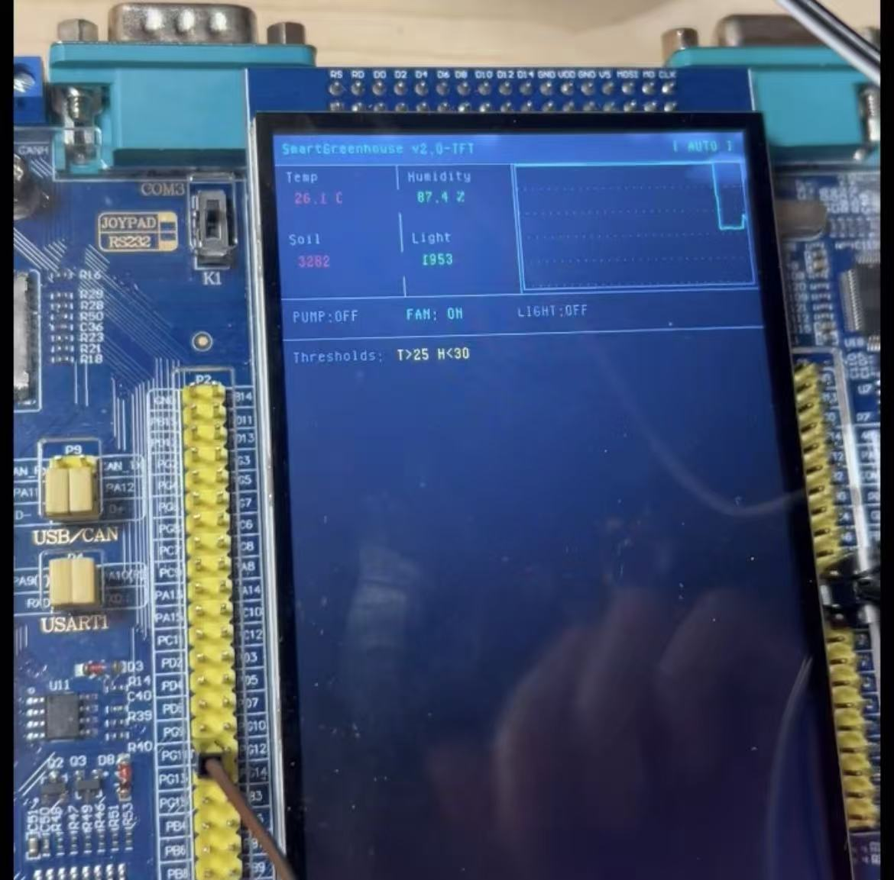

# STM32 Smart Greenhouse

A team-built embedded greenhouse controller based on the STM32F103ZET6, STM32 HAL/CubeMX, and C. It combines environmental sensing, threshold-based actuation, a TFTLCD dashboard, EEPROM history, UART commands, and alarm handling.

See [`AUTHORS.md`](AUTHORS.md) for the team contribution breakdown and [`docs/verification.md`](docs/verification.md) for validation evidence and remaining hardware checks.

## Hardware

- **MCU:** STM32F103ZET6, 72 MHz, LQFP144
- **Air temperature and humidity:** DHT22 on `PG11`
- **Soil moisture:** ADC channel 1 on `PA1`
- **Light intensity:** ADC channel 2 on `PA2`
- **Actuators:** pump `PC0`, fan `PC1`, grow light `PC2`
- **Display:** TFTLCD over 16-bit FSMC
- **History:** AT24C02 EEPROM over I²C
- **Communication:** USART1 at 115200 baud
- **Alerts:** buzzer `PB8`, status LEDs, and TFTLCD alarm banner

The supplied `SmartGreenhouse.ioc` is the authoritative CubeMX configuration. IDE-specific files containing another developer's absolute paths are intentionally excluded.

## Hardware Evidence

The original team defense materials include a complete hardware setup and a recorded demonstration of the TFTLCD interface and actuator control.



- [Full hardware setup](docs/hardware.jpg)
- [Controller and relay connections](docs/controller.png)
- [Recorded hardware demonstration — 3:06, H.264/AAC](docs/demo.mp4)

The video is a compressed copy of the original team recording and is shared with team permission. It documents the original hardware implementation; the later EEPROM robustness fix is verified separately by the host-side regression checks below.

## Firmware Features

- Samples all four sensor values every **200 ms** in the current source.
- Supports automatic, manual, settings, and log-view modes.
- Displays sensor values, actuator state, thresholds, mode, alarm state, and a temperature curve.
- Streams temperature, humidity, soil, and light values as UART CSV.
- Accepts `AUTO`, `MANUAL`, and `DUMP` UART commands.
- Stores six-byte sensor records in a circular EEPROM log holding 40 records.
- Includes a `Hardware_SelfTest` routine, which is not invoked automatically by `main()`.

## Default Control Rules

| Condition | Actuator |
| --- | --- |
| Temperature above `25.0 °C` | Fan on |
| Humidity below `30.0 %RH` | Pump on |
| Soil ADC above `2800` | Pump on |
| Light ADC above `3000` | Grow light on |
| Temperature above `30.0 °C` | Critical alarm |
| Humidity below `15.0 %RH` | Critical alarm |

The current code assumes that a **higher** soil ADC value means drier soil and a **higher** light ADC value means less light. Confirm this polarity against the actual sensor modules before hardware testing. The `soil_dry` and `light_low` names should be interpreted together with those comparisons.

## Repository Layout

```text
App/
├── Inc/                     # Application and BSP interfaces
└── Src/                     # Control, UI, sensors, EEPROM, UART, and drivers
Core/
├── Inc/                     # MCU and peripheral declarations
├── Src/                     # Main loop and peripheral initialization
└── Startup/                 # MCU startup code
Drivers/                     # STM32 HAL and CMSIS with original licenses
docs/verification.md
SmartGreenhouse.ioc          # CubeMX configuration
STM32F103ZETX_FLASH.ld       # Linker script
```

## Build Environment

The original generated makefile references **GNU Tools for STM32 14.3.rel1**. A reproducible firmware build requires:

- STM32CubeIDE or an equivalent `arm-none-eabi-gcc` toolchain
- The supplied `.ioc`, application sources, HAL/CMSIS drivers, and linker script

IDE-generated `.cproject`, `.project`, `.settings`, `Debug`, and `.launch` files are not included. Create a project from `SmartGreenhouse.ioc` in STM32CubeIDE and add the supplied source directories; do not reuse the original machine-specific build files.

The current macOS environment does not contain the ARM cross-compiler or target hardware. Firmware linking and on-device behavior have not been rerun for this cleaned candidate.

## Validation

Host-side checks with hardware stubs cover:

- Fan, pump, grow-light, and alarm thresholds
- EEPROM wraparound after more than 40 writes
- Exact traversal of 40 records without reading or writing reserved addresses

Two EEPROM address-width issues were corrected in `App/Src/bsp_eeprom.c`; see [`docs/verification.md`](docs/verification.md).

## License

The team has confirmed public release under the [MIT License](LICENSE). The license applies to original team code, documentation, and media. STMicroelectronics HAL and ARM/CMSIS components retain their original licenses; see [`THIRD_PARTY_NOTICES.md`](THIRD_PARTY_NOTICES.md).
